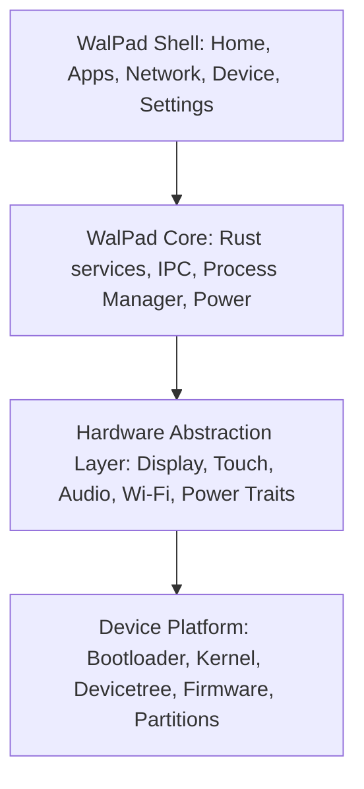

# Multi-Device Architecture for WalPad OS

## 1. Overview
WalPad OS is engineered as a portable, multi-device embedded Linux operating system. Rather than being tightly coupled to a single tablet model (the reference Walton WalPad 8G), WalPad OS decouples common OS components from hardware-specific implementations.

## 2. Four-Layer Architecture
1. **WalPad Shell**:
   - Universal graphical touch UI built on tiny-skia and X11.
   - Completely agnostic to underlying SoC or hardware topology.
   - Communicates exclusively via JSON IPC over UNIX domain sockets.
2. **WalPad Core**:
   - Central system services daemon (`walpad-core`).
   - Manages state, notifications, audio routes, screen rotation, and sleep policies.
   - Interacts with hardware exclusively through the Hardware Abstraction Layer.
3. **Hardware Abstraction Layer (HAL)**:
   - Defined in `crates/walpad-hw/src/domain/capability.rs`.
   - Backend traits: `DisplayBackend`, `BatteryBackend`, `InputBackend`, `AudioBackend`, `NetworkBackend`, `PowerBackend`.
   - Expresses feature availability via the `Capability` enum (`Supported`, `Unsupported`, `Unknown`).
4. **Device Platform**:
   - Kernel, devicetree blobs, proprietary vendor firmware, partition tables, and Android A/B or standard GPT bootloader chains.

## 3. Device Profile System
Hardware differences are declared in structured TOML profiles under `platforms/<manufacturer>/<device-id>/`:
- `device.toml`: Core device metadata, screen resolution, evdev match patterns, capabilities, and tier.
- `hardware.toml`: SoC, CPU cores, RAM, PMIC, and onboard sensor specifications.
- `display.toml`: Framebuffer mode, panel refresh rate, backlight sysfs path, and scaling factor.
- `input.toml`: Touchscreen bus, touch event patterns, and hardware key codes.
- `network.toml`: Wi-Fi chipset, Bluetooth controller name, and telephony modem interface.
- `power.toml`: Battery capacity and status paths, charger voltages, and cpufreq governors.

## 4. Hardware Auto-Detection (`walpad-device-detect`)
When WalPad OS boots:
1. It queries `/proc/cpuinfo` and devicetree compatible strings (`/sys/firmware/devicetree/base/compatible`).
2. It probes available input devices via evdev sysfs names.
3. It detects backlight and power supply paths.
4. It matches discovered identifiers against known profiles in `/etc/walpad/device.toml` or `platforms/`.
5. If no match is found, it loads `arm64-generic` safe fallback mode.

## 5. Three-Tier Compatibility Classification
- **Tier 1 (Fully Supported Reference)**:
  - Complete hardware certification. Display, multi-touch, physical buttons, Wi-Fi, audio output, battery charging, and sleep/wake tested.
  - Reference device: Walton WalPad 8G (`walton-walpad-8g`).
- **Tier 2 (Basic Operation)**:
  - Boots kernel, initializes display and touch input, runs graphical shell and essential apps.
  - May have known limitations (e.g. absent cellular modem support, unaccelerated video, missing camera).
- **Tier 3 (Experimental / Generic)**:
  - Standard Linux kernel and evdev input. Basic desktop environment running in fallback configuration.
