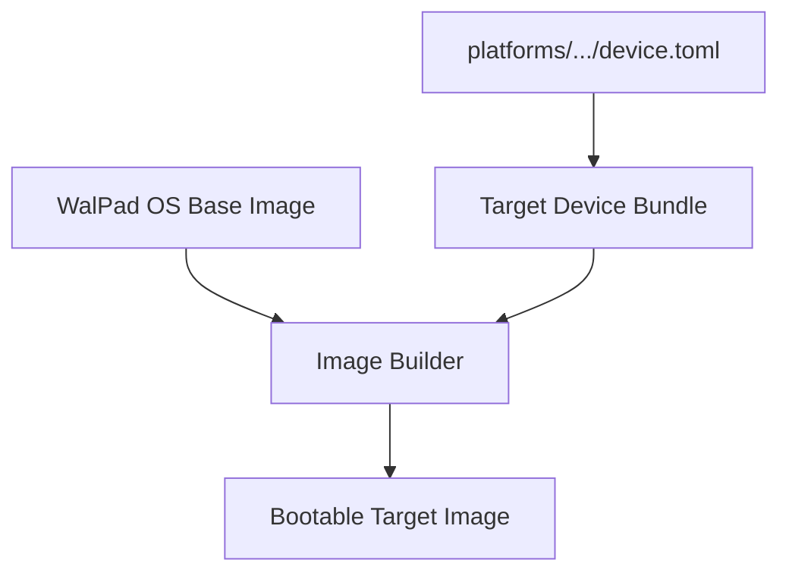

# WalPad OS Image Builder

## Architecture
The image builder decouples operating system generation into two distinct, independently maintained artifacts:
1. **WalPad OS Base Image** (`images/generic-rootfs`): Device-agnostic Alpine Linux root filesystem containing core Rust daemons, X11 shell, and system packages.
2. **Device Bundle** (`images/device-bundles/<device-id>`): Hardware-specific kernel, devicetree, firmware blobs, and device profile.



## Assembly Workflow
```bash
# Combine base image with target device bundle
tools/image-builder/build-device-image.sh \
  --base images/generic-rootfs.tar.gz \
  --bundle images/device-bundles/walton-walpad-8g \
  --output build/walton-walpad-8g-os.img
```

## Guarantees
- The base image builds once and is shared across all ARM64 tablets.
- Device bundles change only when kernel, devicetree, or proprietary firmware change.
- New tablet ports require creating a device profile and bundle, leaving the OS core untouched.
